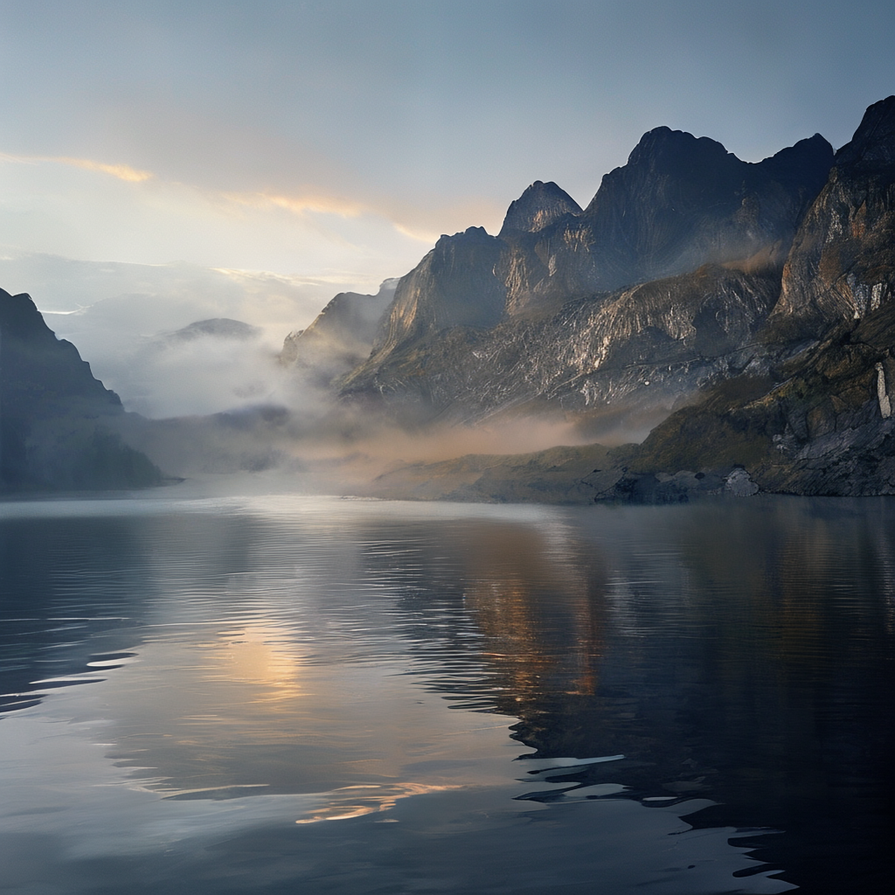
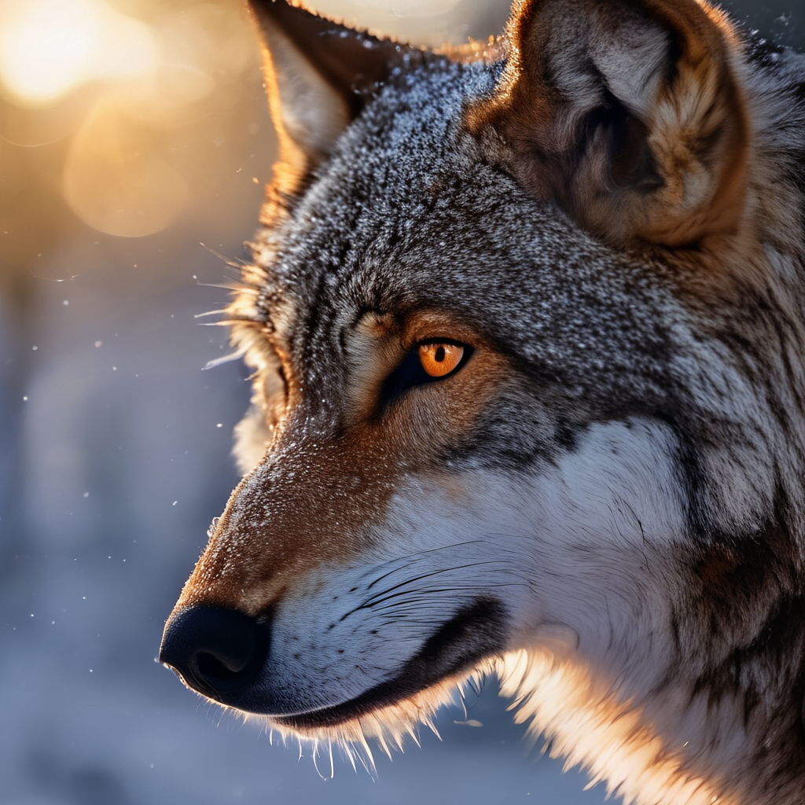
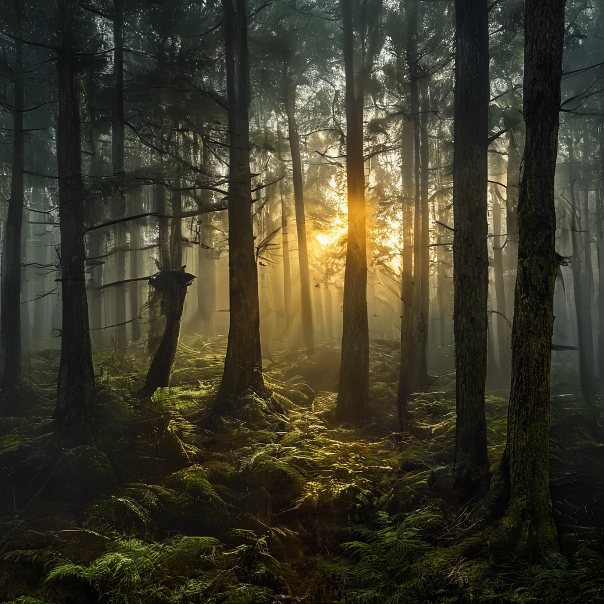
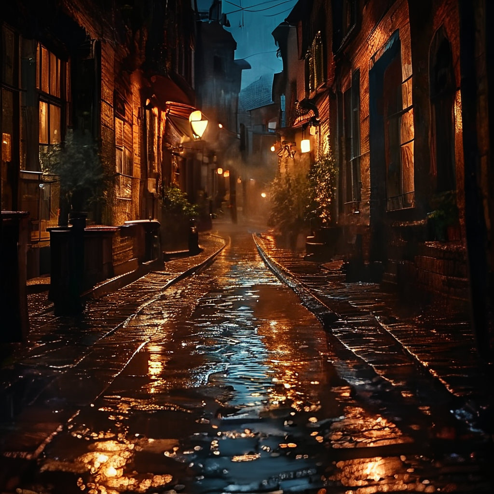
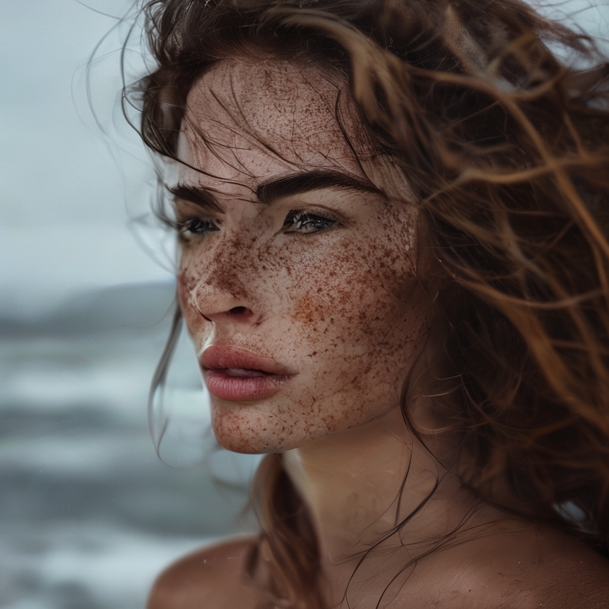
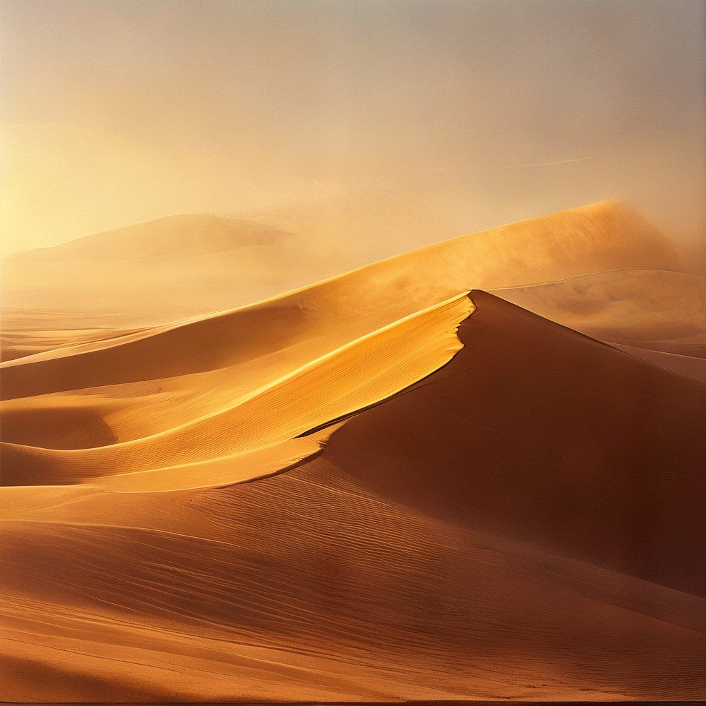

# SANA-Sprint 0.6B text encoder NF4

Gemma-2-2B text encoder from
[Sana_Sprint_0.6B_1024px_diffusers](https://huggingface.co/Efficient-Large-Model/Sana_Sprint_0.6B_1024px_diffusers),
quantized to bitsandbytes NF4 (double quant, bf16 compute). ~5 GB in bf16, 2.2 GB here.

```python
import torch
from diffusers import SanaSprintPipeline
from transformers import Gemma2Model

te = Gemma2Model.from_pretrained("cukrus/sana-sprint-gemma2-2b-nf4",
                                 torch_dtype=torch.bfloat16, device_map={"": 0})
pipe = SanaSprintPipeline.from_pretrained("Efficient-Large-Model/Sana_Sprint_0.6B_1024px_diffusers",
                                          text_encoder=te, torch_dtype=torch.bfloat16).to("cuda")
image = pipe("a red fox standing in fresh snow, golden hour, photorealistic", num_inference_steps=2).images[0]
```

## Examples

SANA-Sprint 0.6B with this encoder on a Jetson Orin Nano 8GB. 1024x1024, 2 steps, seed 4200.

| | | |
|---|---|---|
|  |  |  |
|  |  |  |

<details>
<summary>prompts</summary>

- a glacial lake at first light, low mist tearing across still water, dark granite peaks catching the first warm sun, heavy weather breaking up, mirror reflections, large-format landscape photograph
- extreme close-up of a wolf in falling snow, backlit by a low winter sun, individual guard hairs rimmed with light, frozen breath in the air, amber eye tack sharp, wildlife photograph
- an ancient pine forest in dense fog at first light, shafts of sun cutting between wet trunks, moss and ferns on the floor, deep aerial perspective, atmospheric landscape photograph
- a narrow old-town street after heavy rain at night, wet cobblestones mirroring warm shop lights, steam rising from a grate, deep shadows and glowing highlights, cinematic night photography
- close-up portrait of a woman with windblown hair against a stormy coastline, soft overcast light, freckles and skin texture sharp, sea spray behind her, shallow depth of field, 85mm portrait photograph
- vast desert dunes at golden hour, long knife-edge shadows down the sand, wind lifting a fine plume off the crest, warm haze on the horizon, large-format landscape photograph

</details>

## Sanity check vs bf16

| | cosine vs bf16 | rel. L2 |
|---|---|---|
| NF4 | 0.943 | 0.344 |
| int8 | 0.983 | 0.186 |

No consistent image quality difference between NF4, int8 and bf16 over 6 test prompts.

## Jetson Orin Nano 8GB

JetPack 7.2, torch 2.12.1+cu132. Full pipeline resident, 1024px, 2 steps, tiled decode:
~4 s per image, 4.18 GB peak.

## License

Gemma derivative: [Gemma Terms of Use](https://ai.google.dev/gemma/terms) and
[Prohibited Use Policy](https://ai.google.dev/gemma/prohibited_use_policy) apply.
SANA is under NVIDIA's NSCL v2-custom licence (non-commercial), see the
[original card](https://huggingface.co/Efficient-Large-Model/Sana_Sprint_0.6B_1024px_diffusers).
